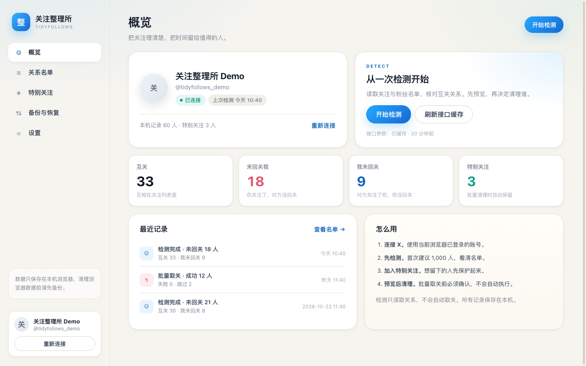
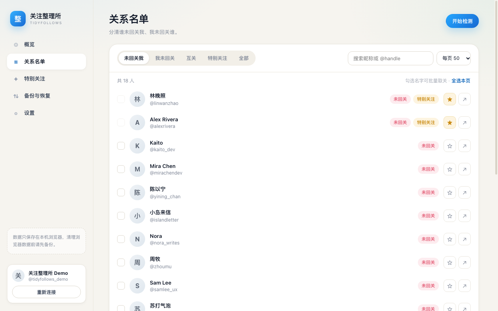
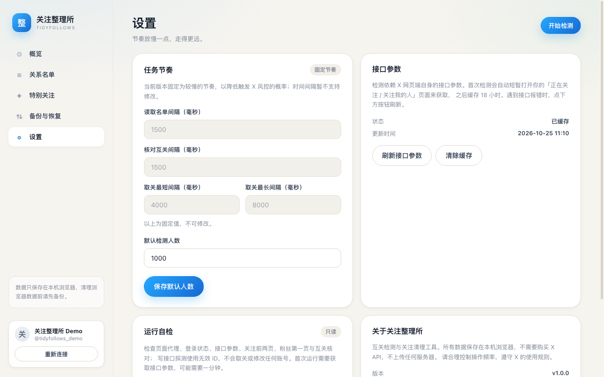

# 关注整理所 · TidyFollows

一个 Manifest V3 的 Chrome 扩展：检测 X（Twitter）互关关系，找出没有回关你的人，在你确认后逐个清理。

所有数据保存在本机浏览器，不需要购买 X API，不需要服务器。



## 功能

- **互关检测**：读取「正在关注」与「关注我的人」两份名单，再用 `friendships/lookup` 精确核对每个人的互关状态。粉丝名单不可用时自动降级，仍可准确统计「未回关我」，仅「我未回关」本次不可用。
- **批量取关**：先勾选、预览、确认，再逐个执行；特别关注自动跳过；随机间隔；随时停止，中断后可继续。
- **特别关注**：按人保护，批量清理时永不触碰。
- **备份与恢复**：JSON 导入导出；清空数据前一键备份。
- **一键自检**：在「设置 → 运行自检」检查页面代理、登录状态、接口参数、关注前两页、粉丝第一页、互关核对与写接口（无效 ID 探测）。除探测请求外不改动任何名单，结果可一键复制。
- **工程细节**：429 限流自动等待、接口参数过期自动刷新、任务进度落盘、后台页关闭自动标记中断。





## 安装

1. 下载或克隆本目录。
2. 打开 `chrome://extensions`，右上角开启「开发者模式」。
3. 点击「加载已解压的扩展程序」，选择**直接包含 `manifest.json`** 的这一层目录。
4. 在浏览器里登录 [x.com](https://x.com)，点击扩展图标 →「连接 X 账号」。
5. 首次检测建议先测 1,000 人，确认名单后再清理。

> 更新时：用新文件替换原目录中的程序文件，然后在扩展管理页点「重新加载」。不要先卸载，以免丢失本机数据。

## 使用流程

1. 连接 X 账号（读取当前浏览器已登录的会话）。
2. 点「开始检测」，选择 1,000 / 3,000 / 全部。首次检测会自动**短暂打开两个后台标签页**（你的「正在关注」和「关注我的人」页面），用于获取 X 网页端的接口参数；参数会缓存 18 小时。
3. 检测完成后进入「关系名单」，查看未回关我 / 我未回关 / 互关。
4. 想留下的人先加入「特别关注」。
5. 勾选要清理的人 →「批量取关」→ 预览确认。取关按固定的 4–8 秒随机间隔逐个执行，可随时停止。
6. 需要留档时到「备份与恢复」导出 JSON。

检测只读取关系，**不会自动取关**；取关必须经过你勾选和二次确认。

## 实现原理

X 网页端没有公开 API 给个人使用，本扩展走的是网页端自己的会话：

```
扩展页面  ←runtime→  background.js (MV3 Service Worker)
                         │ 编排任务 / 打开专用执行页 / 缓存接口参数
                         ▼
                  x.com 标签页（专用后台页）
                   ├─ bridge.js（隔离世界）：分页、核对、取关、进度落盘
                   └─ agent.js（MAIN world）：记录 X 客户端请求头，代为发请求
```

- `agent.js` 在 `document_start` 旁路 `fetch` / `XMLHttpRequest`，记录 X 网页端真实请求里的 `queryId`、`features`、`authorization`、`x-csrf-token`、`x-client-transaction-id`。
- 名单通过 GraphQL 的 `Following` / `Followers` 分页接口读取，解析 `TimelineUser` 条目。第一页优先使用**捕获到的网页端原始响应**（`Followers` 的 transaction-id 无法重放）；后续页失败时标记为部分可用，不丢弃已读数据。
- 互关状态用 `GET /i/api/1.1/friendships/lookup.json` 精确核对，每批 100 人。
- 取关用 `POST /i/api/1.1/friendships/destroy.json`，逐条执行。
- 请求在 x.com 页面上下文发出（`credentials: 'include'`），绕开扩展跨域 CORS 限制，不需要 X API Key。
- 接口参数过期或捕获失败时，自动重新打开名单页刷新；429 按 `x-rate-limit-reset` 等待。
- 每次检测以 `scanId` 标记本次范围；未被本次扫描到的人保留为历史记录，不参与统计和批量操作，避免用旧状态误判。

## 目录结构

```
manifest.json
background.js              # Service Worker：任务编排、标签页、接口参数缓存
src/
  page/
    agent.js               # MAIN world：请求捕获 + 代发请求
    bridge.js              # 隔离世界：检测 / 取关 / 续跑 / 落盘
  ui/
    popup.html/css/js      # 工具栏弹窗
    dashboard.html/css/js  # 控制台（概览、名单、保护、备份、设置）
    common.css
icons/                     # 16/32/48/128 图标
docs/                      # README 预览图、上架材料、提交清单
scripts/package.sh         # 生成商店上传用的 ZIP（输出到 dist/）
scripts/dev/               # headless 运行时测试、商店截图与宣传图生成脚本
site/                      # 隐私政策与支持站点（Cloudflare Workers 静态资源）
```

## 数据与隐私

- 所有数据使用 `chrome.storage.local` 保存在本机：账号、关系记录、特别关注、任务进度、接口参数缓存。
- 没有自建服务器，不上传任何名单、账号或任务数据。
- 分享卡已移除（本地 Canvas 代码与入口一并删除）。
- 清理浏览器数据、卸载扩展或换电脑前，请先导出备份。
- 隐私政策：<https://tidyfollows.1475369.xyz/privacy>
- 支持与故障排查：<https://tidyfollows.1475369.xyz/support>

## 限制与注意

- 依赖 X 网页端的内部接口，X 更新接口后可能暂时失效。可在「设置 → 接口参数 → 刷新接口参数」重新捕获。
- 检测**看不到真实的关注时间**。本机记录的是首次检测时间和最近检测时间。
- 选择「指定人数」时，统计只代表本次扫描范围，不代表账号全部关系。
- 批量取关存在账号风险（限流、临时限制）。当前固定 4–8 秒随机间隔，建议不要一次清理过多，也不要频繁执行。
- 时间间隔在设置中为只读：读取名单 / 核对互关 1.5 秒，取关 4–8 秒。旧版本或导入的备份不会覆盖这些值。
- 任务运行期间可以浏览其他页面，但**不要关闭或刷新专用执行页**；关闭后任务会标记为中断，可点「继续」从进度处续跑。
- 需要浏览器里已登录 x.com，不支持未登录状态。
- 本项目用于个人整理账号关系，请自行遵守 X 的服务条款与当地法律法规。

## 开发与验证

```bash
for f in background.js src/page/agent.js src/page/bridge.js src/ui/popup.js src/ui/dashboard.js; do node --check "$f"; done
```

本项目在 Chrome for Testing 156（headless）中完成了以下运行时验证，脚本见 `scripts/dev/`：

- 扩展加载、Service Worker 启动、控制台与弹窗渲染，无异常或警告；版本 1.0.0。
- 概览 / 关系名单 / 特别关注 / 备份 / 设置五个页面均可切换；关系统计、勾选与批量条正常。
- 分享卡页面、Canvas、路由与代码已完全移除，无残留引用。
- 备份导出不包含 `lanCaptures`（会话请求头）、`lanWarmups`、`lanTask`、`lanWorkerTab`；导入时同样跳过这些字段。
- 清空数据、清除接口缓存、开始检测弹窗、弹窗「打开控制台」均正常。
- 两个内容脚本分别在 MAIN world 与隔离 world 注入成功。
- 用 CDP `Fetch` 伪造 x.com 文档与接口，端到端跑通「关注/粉丝分页 → 互关核对 → 统计 → 批量取关」；特别关注跳过、关系落盘、历史记录均正确。
- 模拟粉丝接口 401：检测降级完成，「未回关我」正常，「我未回关」置为不可用并给出说明。

未覆盖：真实登录会话、真实 X 接口与限流恢复。headless Chrome 访问 x.com 会返回 403，真实账号回归仍需人工执行——建议首次使用时先用小范围检测确认。

## 故障排查

先在「设置 → 运行自检」跑一次只读检查：

- **账号连接失败**：确认浏览器里已登录 x.com；必要时重新登录后再连。
- **接口参数失败**：点「刷新接口参数」，或手动打开一次自己的「正在关注」页面。
- **读取关注第一页 403 / 404**：接口参数或 transaction-id 过期，刷新后重试。
- **读取关注第一页 429**：被限流，自检会显示恢复时间；等待后重试。
- **粉丝接口 404**：不影响「谁没回关我」，检测会自动降级完成；「我未回关」本次显示为 `—`。
- **解析到 0 人**：X 可能返回了登录页或空数据，确认账号状态后刷新参数重试。
- **写接口探测告警（404）**：X 可能移除了 v1.1 取关接口。真实取关前先用小号验证一次；如果确实失败，需要改用网页端 GraphQL 取关，请把自检结果发给开发者。

自检结果可点「复制结果」，附上版本号与浏览器信息便于排查。

## 更新日志

### 1.0.0

- 首个商店版本。
- 移除分享卡模块（界面、样式与 Canvas 代码）。
- 备份导出不再包含接口参数缓存（含会话请求头）与临时标签页状态；导入时会跳过这些字段。
- 品牌与内部文案统一为「关注整理所 / TidyFollows」。

### 0.2.0

- 品牌更名为「关注整理所 / TidyFollows」，替换 manifest、界面、文案与图标。
- 新图标：蓝色清单 + 勾，和原「蓝朋友」彻底切割。
- 分享卡继续下线；时间间隔保持固定（名单/核对 1.5 秒，取关 4–8 秒）。
- 新增 `docs/store-listing.md` 与 `docs/privacy-policy.md`，用于 Chrome 商店上架。

### 0.1.9

- 分享卡暂时下线，控制台入口移除。
- 时间间隔调大并固定：名单读取 / 互关核对 1.5 秒，取关 4–8 秒。
- 设置页的时间间隔改为只读并灰色显示，只保留「默认检测人数」可修改；旧设置和导入备份不会覆盖固定间隔。

### 0.1.8

- 关键修复：X 网页端对 `Followers` 的 `x-client-transaction-id` 做了请求绑定，重放必然 404。现在改为**捕获网页端自己返回的响应体**作为第一页数据，不再重放敏感请求。
- `Following` / `Followers` 的第一页都优先使用捕获响应；粉丝页 404 警告随之消失。
- 粉丝名单只拿到第一页时标记为「不完整」，不会丢弃已有数据；后续页失败时降级继续。
- 自检显示 `body✓ / body—`，可确认是否捕获到响应体。
- 注意：更新扩展后请在 `chrome://extensions` 点一次「重新加载」，避免后台 Service Worker 使用旧脚本。

### 0.1.7

- 捕获并回放 X 网页端请求的**完整请求头**（authorization、x-csrf-token、x-client-transaction-id、x-twitter-client-language 等）和原始 URL，修复重放请求被 404 的问题。
- 自检的接口参数行显示捕获到的请求头数量（hdrN）与预热请求响应码（warm200 / warm404）。

### 0.1.6

- 粉丝名单接口不可用时自动降级：继续用 `friendships/lookup` 完成「未回关我」检测，仅「我未回关」标记为不可用。
- 自检把粉丝接口失败记为警告，并在界面上说明主检测仍可用。
- 概览、关系名单、弹窗在「我未回关」不可用时显示 `—` 和原因说明。

### 0.1.5

- 记录并展示 X 网页端预热请求自身的响应码（`warm200` / `warm404`），用于区分「我们的请求构造问题」和「X 端接口问题」。
- 第一页改用预热时「无 cursor」的原始变量，不再改写捕获到的其他变量字段。
- 接口 404 且刷新无效时，自动用捕获的原始参数原样重放一次并报告结果。

### 0.1.4

- 接口参数改为按 operation 校验新鲜度，修复「Following 已刷新、Followers 仍是旧 queryId」导致的粉丝接口 404。
- 自检遇到 400/403/404 会自动重新捕获参数并重试一次，失败时附带响应内容片段。
- 写接口探测增加空 body 二次探测，无法确认时标记为警告，提醒先用小号验证真实取关。
- 账号兜底预热只接受本次新捕获的 Following 参数。

### 0.1.3

- 修复真实环境账号连接失败：`verify_credentials` 返回 404 时，依次改用页面账号、`account/settings`、`users/show`、关注页 GraphQL 参数识别当前账号，并用关注页响应校验 `screenName`。
- 自检的账号连接步骤会显示实际使用的方式（`legacy-api` / `graphql-warmup`）。

### 0.1.2

- 自检升级为完整 E2E：关注前两页（验证 cursor 翻页）、粉丝第一页、互关核对，以及使用无效 ID 的写接口探测。
- 自检显示每一步耗时与限流剩余额度，便于定位限流问题。

### 0.1.1

- 新增「运行自检」：只读检查连接、接口参数、关注第一页与互关核对，并支持复制结果。
- 修复多个 GraphQL 接口参数同时到达时的缓存覆盖问题。
- 取关任务中断时立即落盘已完成的进度；连续失败 5 次自动停止。
- 检测结果按本次扫描范围统计，历史记录标记为 stale，不参与批量清理。

### 0.1.0

- 首个版本：互关检测、批量取关、特别关注、分享卡、备份恢复、任务续跑。
